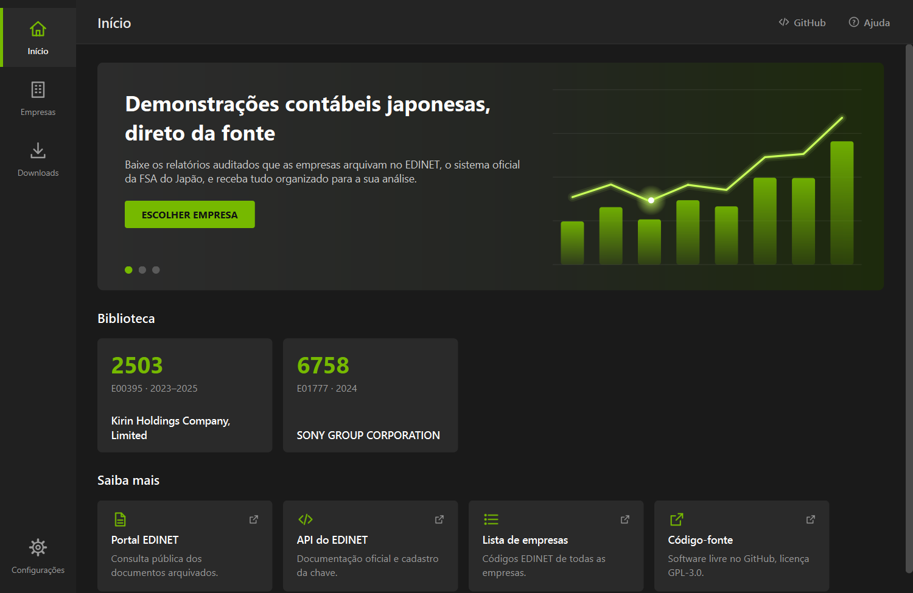
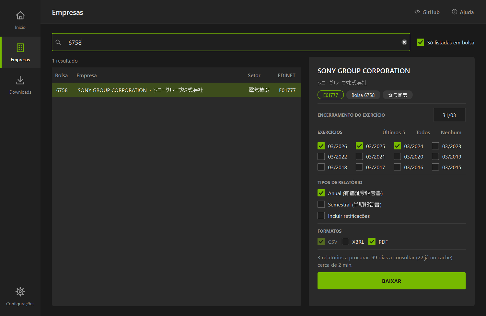

# Yuho Reader

Programa para Windows que baixa as demonstrações contábeis auditadas de empresas japonesas pela API
oficial do [EDINET](https://disclosure2.edinet-fsa.go.jp/) e monta uma planilha Excel pronta para
análise econômico-financeira.

O nome vem de *yūhō* (有報), a forma curta de 有価証券報告書, o relatório anual que as companhias
abertas japonesas arquivam no EDINET.

> **Em desenvolvimento.** O programa já funciona a partir do código-fonte (veja abaixo). A versão
> para download, com instalador, ainda vai ser lançada.

> **Aviso.** O Yuho Reader não é um programa oficial e não tem ligação com a Financial Services
> Agency (FSA) do Japão nem com o EDINET.

## O que o programa faz

- **Encontra a empresa** pelo nome (inglês, japonês ou kana), pelo código da bolsa (ex.: `6758`) ou
  pelo código EDINET (ex.: `E01777`), usando a lista pública de empresas do EDINET.
- **Localiza os relatórios** anuais (有価証券報告書) e semestrais (半期報告書, ou o trimestral do
  2º trimestre nos anos antigos) dos exercícios que você escolher, com ou sem retificações.
- **Baixa os arquivos oficiais**: os dados em CSV, e opcionalmente o XBRL original e o PDF.
- **Monta uma planilha Excel por empresa**, com as abas:
  - `INDICE` — um relatório por linha, com período, data de envio, arquivos salvos e link do PDF;
  - `PAINEL` — as contas nas linhas e um relatório por coluna, lado a lado;
  - `DEMONSTRACOES` — as mesmas contas em formato longo, com todas as colunas do EDINET;
  - uma aba por relatório, com todos os dados do CSV.
- Funciona com empresas que publicam em **J-GAAP** e em **IFRS**, usando o consolidado (ou o
  individual, quando a empresa não consolida).

Tudo fica em `Documentos\Yuho Reader\<código>_<nome>\`. O que já foi baixado não é baixado de novo.

## Capturas de tela





## Como rodar a partir do código

Você precisa de Windows 10 ou 11, [Python 3.12](https://www.python.org/downloads/) e uma chave da API
do EDINET (gratuita; o cadastro é feito no próprio site do EDINET).

```
git clone https://github.com/walterlijunior/yuho-reader.git
cd yuho-reader
py -3.12 -m venv .venv
.venv\Scripts\python -m pip install -r requirements.txt
.venv\Scripts\python run.py
```

Depois, no programa:

1. Em **Configurações**, cole a chave da API, clique em SALVAR e em TESTAR.
2. Em **Empresas**, pesquise a empresa e clique nela.
3. Marque os exercícios, os tipos de relatório e os formatos, e clique em **BAIXAR**.
4. Acompanhe em **Downloads** e, ao terminar, clique em ABRIR PLANILHA.

A chave fica guardada somente no seu computador, em `%APPDATA%\YuhoReader\config.json`. Ela nunca
entra no código nem neste repositório.

Para rodar os testes (não usam a internet nem a chave):

```
.venv\Scripts\python -m pip install -r requirements-dev.txt
.venv\Scripts\python -m pytest
```

## Como funciona

O EDINET não tem busca por empresa: a API só lista tudo o que foi arquivado em um determinado dia.
Por isso o programa calcula, a partir da data de encerramento do exercício, a janela em que cada
relatório costuma ser entregue (de 55 a 100 dias depois, no caso do anual; de 25 a 50 dias, no do
semestral) e consulta só os dias úteis dessa janela, parando assim que encontra o documento. A
lista de cada dia já consultado fica em cache no computador, então repetir uma busca é instantâneo.
Entre uma chamada e outra há uma pausa (0,5 s por padrão) para não sobrecarregar o EDINET.

## Estrutura das pastas

```
run.py                 abre o programa
core/                  a lógica, sem nada de interface
  api.py               conversa com a API do EDINET (pausa, novas tentativas, cache)
  companies.py         lista de empresas e pesquisa
  periods.py           exercícios, janelas de datas e estimativa de tempo
  search.py            localiza os relatórios de uma empresa, dia a dia
  parser.py            lê os CSV do EDINET e separa as contas das demonstrações
  excel.py             monta a planilha
  job.py               a tarefa completa: procurar, baixar e montar a planilha
  config.py            pastas do programa e configurações do usuário
ui/                    a interface (PySide6), uma página por arquivo
  main_window.py       janela, barra lateral e cabeçalho
  page_home.py         Início
  page_companies.py    Empresas
  page_downloads.py    Downloads
  page_settings.py     Configurações
  theme.py, icons.py, art.py, widgets.py, state.py
tests/                 testes com um EDINET simulado
docs/                  capturas de tela
```

## Sobre os dados

Os documentos e os números vêm do EDINET, mantido pela Financial Services Agency (FSA) do Japão, e
são públicos. O Yuho Reader apenas lê e baixa esses documentos; ele não altera nem garante o
conteúdo deles. Confira sempre os valores com o relatório original antes de usá-los.

## Como contribuir

Veja o [CONTRIBUTING.md](CONTRIBUTING.md).

## Licença

O Yuho Reader é **software livre**, distribuído sob a
[GNU General Public License, versão 3 ou posterior](LICENSE) (GPL-3.0-or-later).
Copyright (C) 2026 walterlijunior.

Em linguagem simples:

- qualquer pessoa pode **usar, estudar, modificar e redistribuir** o programa;
- quem distribuir uma **versão modificada** precisa manter o código aberto, sob a mesma GPL-3.0;
- o programa é oferecido **sem nenhuma garantia**;
- o nome **“Yuho Reader” não está incluído na licença**: versões modificadas devem usar outro nome.

O programa usa as bibliotecas PySide6 (LGPL-3.0), requests (Apache-2.0), pandas (BSD-3-Clause) e
openpyxl (MIT), todas compatíveis com a GPL-3.0.
